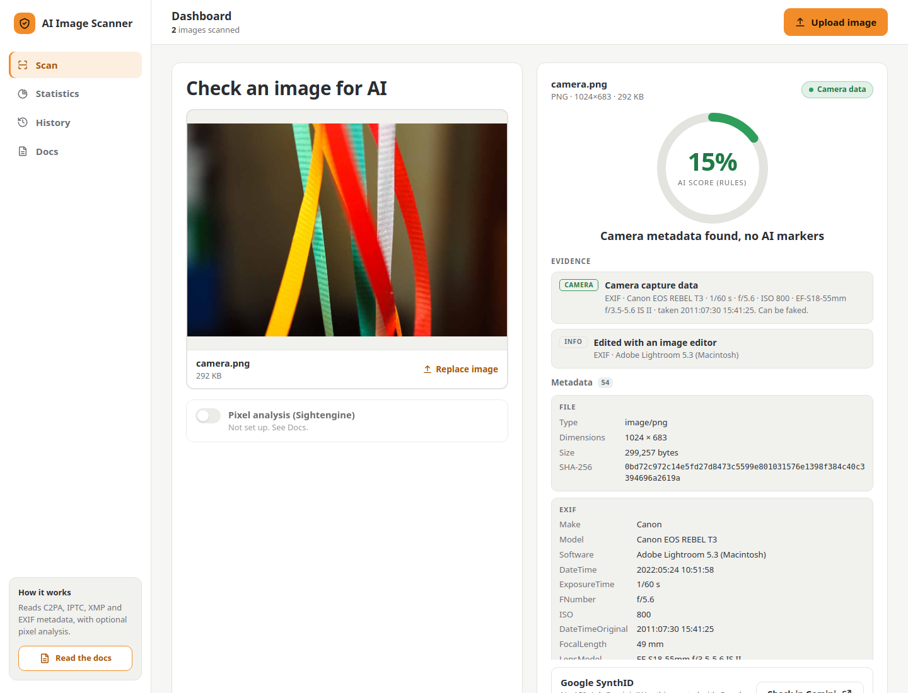

# AI Image Scanner

A personal forensic tool that checks whether an image was made or edited by AI. Upload a JPEG, PNG or WebP and it
reads the evidence stored inside the file (Content Credentials, IPTC and XMP tags, EXIF camera data, generator
settings) and, if you switch it on, asks a pixel-analysis model. Every verdict lists the evidence behind it.

Plain PHP on a LAMP stack (Ubuntu 24.04, Apache, MariaDB, PHP 8.3) in a single, hardened Docker container.



## Features

- **Metadata forensics.** Parses C2PA manifests (JUMBF + CBOR), XMP, IPTC-IIM, EXIF and PNG text chunks
  structurally, not by keyword search.
- **Evidence you can check.** Each finding shows its strength and where it was found, and a **Metadata** panel
  lists every field that was read.
- **Optional pixel analysis.** Sightengine's AI-image model scores the pixels, so screenshots and stripped files are
  covered too. Off by default, chosen per scan.
- **Google SynthID.** No public API exists, so the result links to Gemini for a manual check.
- **Dashboard.** Statistics, filterable history with thumbnails and scores, delete one scan or clear all.
- **Docs page** built in, light and dark themes, works from phone to wide screen.

## Quick start

```bash
docker build -t ai-scanner .
docker run -d --name ai-scanner -p 127.0.0.1:8090:8080 -v scanner-db:/var/lib/mysql ai-scanner
```

Open <http://localhost:8090>. Scan history lives in the `scanner-db` volume.

Once the [publishing workflow](#publishing) has run, you can pull `isaka12/ai-image-detector-lamp:latest` instead of building.

### With pixel analysis

Create a [Sightengine](https://sightengine.com) account and put its settings in `.env` (see `.env.example`):

```ini
SIGHTENGINE_ENDPOINT=https://api.sightengine.com/1.0/check.json
API_USER=your_api_user
SIGHTENGINE_API_KEY=your_api_secret
```

Mount the file read-only. Do not use `-e` or `--env-file`: those values show up in `docker inspect`.

```bash
chmod 600 .env
docker run -d --name ai-scanner -p 127.0.0.1:8090:8080 \
  -v scanner-db:/var/lib/mysql \
  -v "$PWD/.env:/run/secrets/scanner.env:ro" ai-scanner
```

### Hardened run

Same app with only the capabilities it needs, plus memory and process limits:

```bash
docker run -d --name ai-scanner -p 127.0.0.1:8090:8080 \
  --cap-drop ALL --cap-add CHOWN --cap-add SETUID --cap-add SETGID --cap-add DAC_OVERRIDE \
  --security-opt no-new-privileges --pids-limit 200 --memory 512m \
  -v scanner-db:/var/lib/mysql \
  -v "$PWD/.env:/run/secrets/scanner.env:ro" ai-scanner
```

Publish on `127.0.0.1` only: anyone who can open the page can also delete the history.

## How it works

1. The upload is checked: real type from the content (not the file name), JPEG, PNG or WebP, up to 10 MB.
2. The file's container is walked and each metadata block parsed. Pixels are never decoded.
3. Rules turn what was found into evidence. The strongest evidence decides the result.
4. If pixel analysis is on, Sightengine's probability becomes the score.

| Evidence | Found in | Strength |
|---|---|---|
| Declared AI-generated or AI-edited (`DigitalSourceType`) | C2PA, XMP | strong |
| Declared AI system or prompt (`AISystemUsed`, `AIPromptInformation`) | XMP | strong |
| Generation settings: AUTOMATIC1111, Forge, ComfyUI, InvokeAI, Fooocus, SwarmUI, NovelAI | PNG text, EXIF comments, IPTC caption | strong |
| "Made with Google AI" label | IPTC, XMP, EXIF | medium |
| AI tool named as software, author or credit | EXIF, IPTC, XMP, C2PA | medium |
| Midjourney job ID, "algorithmic media" source | PNG text, C2PA, XMP | medium |
| Typical generator image size | Image header | weak |
| Camera make, model and exposure | EXIF | camera |
| Editor used, resized since capture, no metadata | EXIF, XMP | info |

| Result | Score without pixel analysis |
|---|---|
| AI declared | 95% |
| Likely AI | 75% |
| Weak hints | 55% |
| Camera data | 15% |
| Inconclusive | N/A |

These fixed scores are labelled `RULES`. With pixel analysis the score is Sightengine's measured probability,
labelled `SIGHTENGINE`. Declared AI never scores below 95%.

## Limits

- Results are evidence, not proof.
- Metadata can be stripped (screenshots, social media) or faked.
- C2PA signatures are not verified, so a manifest is a claim.
- Pixel models make mistakes, especially on heavily compressed images and new generators.
- SynthID cannot be checked automatically.

## Privacy

- The image is never stored on the server. Each scan keeps its SHA-256, size, type, result, score, evidence and file
  name.
- History thumbnails are made by the browser and stay there.
- GPS is reported as present or absent, never as coordinates.
- Pixel analysis sends the image to Sightengine, which is why it is opt-in.

## Project structure

```
app/                  PHP code, outside the web root
  Detector.php        rules, verdict, score and metadata report
  Container.php       walks JPEG / PNG / WebP and extracts metadata blocks
  Exif.php            EXIF / TIFF reader
  Iptc.php            IPTC-IIM reader (Photoshop APP13)
  C2pa.php, Cbor.php  C2PA manifest reader (JUMBF boxes, CBOR)
  Sightengine.php     pixel-analysis client
  Http.php            JSON responses, database connection
  views/sidebar.php   shared sidebar
public/               web root
  index.php           dashboard
  docs.php            user docs
  scan.php            POST: analyse an upload
  history.php         GET: statistics and latest 50 scans
  delete.php          POST: delete one scan or all
  app.js, style.css   front end
docker/               Apache, PHP and entrypoint configuration
tests/run.php         unit tests
tests/smoke.sh        smoke test of a built image
.github/workflows/    test and publish pipeline
```

## Tests

```bash
php tests/run.php          # 47 unit tests, no Composer needed
tests/smoke.sh ai-scanner  # starts the image and tests it over HTTP
```

The unit tests cover every rule, real C2PA samples, known false positives (a Spanish caption
saying "imagen", generator names in captions), hostile files (zip bomb in a PNG chunk, deeply nested CBOR, lying
length fields) and a 300-file mutation fuzz.

The smoke test checks the running container: security headers, `app/` not served, CSRF rejection, a camera photo
and a C2PA file scanned correctly, scans saved, delete one and clear all.

## Security

| Area | Measures |
|---|---|
| Uploads | CSRF token, size limit, type from content, image never stored, pixels never decoded |
| Parsers | Every length bounds-checked; limits on nesting depth, item count and decompressed size |
| PHP | `expose_php` off, dangerous functions disabled, `open_basedir`, no remote includes |
| Apache | Only `public/` served, strict Content-Security-Policy, security headers, no directory listing |
| Database | Unix socket only, new random password on every start, app user limited to SELECT / INSERT / DELETE, prepared statements |
| API keys | Read from a mounted `.env`, never sourced, validated; absent from `docker inspect`, the image and logs |
| Container | Code owned by root and read-only for the web user; tested with all but four capabilities dropped (see Hardened run) |

Not included: HTTPS (put a reverse proxy in front) and rate limiting. Apache and MariaDB share one container, which
is fine for a personal tool.

## Publishing

`.github/workflows/docker-publish.yml` is the pipeline. Nothing is published unless every step passes:

1. **Unit tests and lint:** PHP syntax for every file, JavaScript and shell syntax, then `php tests/run.php`.
2. **Smoke test:** builds the image and runs `tests/smoke.sh` against it.
3. **Publish:** pushes `isaka12/ai-image-detector-lamp` to Docker Hub (not for pull requests).

| Event | Tags |
|---|---|
| Push to `main` | `latest`, `sha-<commit>` |
| Tag `v1.2.3` | `1.2.3`, `1.2`, `sha-<commit>` |
| Pull request | Tests only, nothing pushed |

It needs two repository secrets: `DOCKERHUB_USERNAME` and `DOCKERHUB_TOKEN` (a Docker Hub access token with Read &
Write scope). `.env` is excluded from both git and the image.

## License

[MIT](LICENSE)

The C2PA sample images in `tests/fixtures/` come from the [c2pa-rs](https://github.com/contentauth/c2pa-rs) test
suite (MIT / Apache-2.0).
